  

  

  
  

  

### He who creates.

Tech VP at **Barclays**. Founder of **AFI**. I ship across the whole stack: smart contracts in Rust and Solidity, TypeScript products, Python ML, and the local AI that runs them. Almost all of it lives in private repos, so the numbers above are counted from every repo I commit to, not just the public ones.

### Building now

- **Alexander**. My own LLM swarm on one RTX 5090 laptop: a 27B model, tool-using agents, local web search and a nightly loop that harvests real requests, examines the model and fine-tunes it. It serves production with no cloud API.
- **Halcyon**. [retreatsbyhalcyon.com](https://retreatsbyhalcyon.com): bookings, Stripe checkout, practitioner profiles and an operator console with Alexander built in. Next.js on Postgres.
- **Chains of War**. Browser strategy game: Vite + three.js client, onchain faction economy.
- **AFI**. Agentic finance across 23 chains on LayerZero V2 and Circle CCTP, with Visa rails and native x402.

### Shipped

- **Memetropolis**. $300K LayerZero V2 cross-chain launchpad. Rust and Solidity contracts, subgraph, backend, frontend.
- **Cashly**. Crypto payments and banking, with a LayerZero OFT adapter.
- **BTCSOL**. Solana program in Rust (Anchor), with a Helius-backed client.
- **2gather**. Invite-only social network. Expo + Supabase, four mobile sprints in one day.

  

### Stack

   
  

  

### Contribution snake

<picture>
  <source media="(prefers-color-scheme: dark)" srcset="https://raw.githubusercontent.com/RichardTheBruce/RichardTheBruce/output/github-contribution-grid-snake-dark.svg" />
  <source media="(prefers-color-scheme: light)" srcset="https://raw.githubusercontent.com/RichardTheBruce/RichardTheBruce/output/github-contribution-grid-snake.svg" />
  
</picture>

### Where to find me

- LinkedIn: **[richard-wayne-nuro](https://linkedin.com/in/richard-wayne-nuro)**
- Upwork: catalog **2054540114667442621** (Neural Nets for Everything)

  

